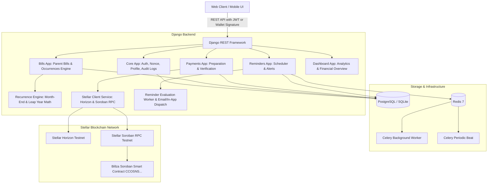

# Billza — Stellar-Integrated Utility Bill Management & Recurring Payments Platform

[](https://stellar.org)
[](https://soroban.stellar.org)
[](https://www.djangoproject.com/)
[](http://localhost:8000/api/docs/)
[](https://www.docker.com/)
[]()

Billza is a Stellar-integrated utility bill management and recurring payments platform designed to help individuals, households, freelancers, and small businesses organize recurring financial obligations, receive automated payment reminders, and initiate verified payments using Stellar Testnet **XLM** and **USDC**.

---

## 🚀 Live Stellar Testnet Smart Contract

The Billza Soroban smart contract is **compiled, verified, deployed, and initialized** on Stellar Testnet:

| Parameter | Value / Link |
|---|---|
| **Contract ID** | [`CCOSNSVHGLYFMO72ICZY2Y7KZYQLZ77AADT4LIU6VL4XDRT2IY6IQMOG`](https://lab.stellar.org/r/testnet/contract/CCOSNSVHGLYFMO72ICZY2Y7KZYQLZ77AADT4LIU6VL4XDRT2IY6IQMOG) |
| **Network** | Stellar Testnet (`Test SDF Network ; September 2015`) |
| **WASM Hash** | `35ae26e09ae957af88f891828b0800dc1a70bd9db908100e77719ec1ddca02bc` |
| **Deploy Transaction** | [`1bba78de3878efd69d75f3222fdca7527ff585f8134c2b490464af154a72c71d`](https://stellar.expert/explorer/testnet/tx/1bba78de3878efd69d75f3222fdca7527ff585f8134c2b490464af154a72c71d) |
| **Initialization Tx** | [`fb4fa3863aa0fa26b7ccbf8020d81b6f450f2bf713378879d4eb2345569f06c2`](https://stellar.expert/explorer/testnet/tx/fb4fa3863aa0fa26b7ccbf8020d81b6f450f2bf713378879d4eb2345569f06c2) |
| **Admin Address** | `GA4KDGQIIXA7SQZB43AIK254XTSGYV3HBX4GAPKU3N2ECP76IX4U557Q` |
| **Stellar Lab Explorer** | [Inspect Contract on Stellar Lab](https://lab.stellar.org/r/testnet/contract/CCOSNSVHGLYFMO72ICZY2Y7KZYQLZ77AADT4LIU6VL4XDRT2IY6IQMOG) |

### Contract Capabilities (`contracts/src/lib.rs`):
- **Non-Custodial Direct Settlement**: Uses Soroban `token::Client` to transfer tokens directly from payer to bill recipient without custodial intermediaries.
- **On-Chain Recurring Advancement**: When a recurring bill is paid, the contract advances the due date based on frequency (Weekly, Monthly, Quarterly, Yearly) while keeping state synchronized.
- **On-Chain Audit Events**: Emits typed Soroban events:
  - `bill_reg`: `(bill_id, payer, recipient, token, amount, due_date, frequency)`
  - `bill_paid`: `(bill_id, payer, recipient, token, amount, reference, timestamp)`
  - `dir_pay`: `(category, payer, recipient, token, amount, reference, timestamp)`
  - `cancel`: `(bill_id, caller)`
- **Platform Fee Configuration**: Optional platform fee (0 bps default, up to 1000 bps).

---

## 🏛️ System Architecture



---

## 📦 Key Backend Features (Function-Based Views)

All API views are built strictly using **Django REST Framework Function-Based Views** (`@api_view`), fully decorated with `@extend_schema` for comprehensive OpenAPI 3.0 Swagger interactive documentation.

### 1. Authentication & Wallet Signature Verification (`core`)
- **Email & Password Authentication**: Standard secure registration and login issuing JWT access and refresh tokens.
- **Cryptographic Stellar Wallet Authentication**:
  1. Frontend requests random challenge nonce via `POST /api/auth/wallet/nonce/`.
  2. User signs the challenge in Freighter / Albedo / Stellar wallet.
  3. Backend verifies the Ed25519 signature via `POST /api/auth/wallet/verify/` using `stellar-sdk` and issues JWT tokens.
- **Security Audit Logs**: Tracks every bill creation, payment attempt, and verification in `AuditLog`.

### 2. Bill & Recurring Schedule Engine (`bills`)
- **Parent Bill vs. Scheduled Occurrences**: Stable parent bill record holds recurrence rules while each payment cycle is a distinct `BillOccurrence`.
- **Calendar Edge Cases Handled**:
  - Month-end dates (e.g., Jan 31 $\rightarrow$ Feb 28 $\rightarrow$ Mar 31).
  - Leap years (Feb 29 $\rightarrow$ Feb 28 next year).
  - Quarterly and yearly date calculations.
- **Occurrence Statuses**: `UPCOMING`, `DUE_SOON`, `OVERDUE`, `PENDING_VERIFICATION`, `PAID`, `CANCELLED`.
- **Manual vs. Blockchain Payments**: Manually marked payments are clearly flagged (`is_manual_paid=True`) to maintain distinction from verified Stellar transactions.
- **Snoozing**: Users can snooze due dates by $N$ days.

### 3. Stellar Payment Preparation & Verification (`payments`)
- **Payment Preparation (`POST /api/payments/prepare/`)**: Validates recipient Stellar address and generates a unique payment reference (e.g., `BILLZA-A1B2C3D4E5F6`).
- **On-Chain Transaction Verification (`POST /api/payments/verify/`)**:
  - Queries Horizon for transaction status.
  - Verifies network is Stellar Testnet.
  - Verifies destination address matches bill recipient.
  - Verifies asset code (`XLM` or `USDC`) and issuer.
  - Verifies transferred amount $\ge$ required bill amount.
  - Verifies memo matches payment reference.
  - **Double-Crediting Prevention**: Enforces uniqueness on `transaction_hash` so the same transaction cannot be reused for multiple occurrences.
  - On confirmation: marks occurrence as paid, updates payment record, and automatically triggers the recurrence engine to schedule the next cycle.
- **Export History**: Download payment records as CSV (`GET /api/payments/history/export-csv/`).
- **Wallet Balances & Faucet**: Real-time testnet XLM/USDC balance queries and 1-click Friendbot funding.

### 4. Automated Reminder System (`reminders`)
- **Configurable Notification Preferences**: Email and in-app toggles with multi-tier alerts:
  - 7 days before due date
  - 3 days before due date
  - 1 day before due date
  - On due date
  - Overdue alert
- **Idempotent Background Worker (`POST /api/reminders/worker/run/`)**: Evaluates unpaid occurrences, dispatches alerts, and avoids duplicate reminders.
- In-app reminder read/unread tracking and batch mark-read.

### 5. Dashboard & Financial Metrics (`dashboard`)
- **Summary Cards**: Total bills, upcoming bills, overdue obligations, paid this month, unread reminders.
- **Multi-Currency Segregation**: Sums denominated in different currencies (XLM, USDC, USD) are presented in separate breakdown lists and **never combined artificially**.
- **Category Expense Breakdown**: Aggregations across Electricity, Internet, Water, Rent, Subscriptions, Education, Insurance, and Business Utilities.

---

## 📚 API Endpoints & Swagger Documentation

Once the server is running, explore the interactive OpenAPI 3.0 documentation:
- **Swagger UI**: [http://localhost:8000/api/docs/](http://localhost:8000/api/docs/)
- **ReDoc**: [http://localhost:8000/api/redoc/](http://localhost:8000/api/redoc/)
- **OpenAPI Schema**: [http://localhost:8000/api/schema/](http://localhost:8000/api/schema/)

| Category | Method | Endpoint | Description | Auth |
|---|---|---|---|---|
| **Auth** | `POST` | `/api/auth/register/` | Register new user account | Public |
| **Auth** | `POST` | `/api/auth/login/` | User login (returns JWT tokens) | Public |
| **Auth** | `POST` | `/api/auth/wallet/nonce/` | Request Stellar wallet challenge nonce | Public |
| **Auth** | `POST` | `/api/auth/wallet/verify/` | Verify wallet signature & authenticate | Public |
| **Auth** | `GET/PATCH` | `/api/auth/profile/` | Get or update profile & preferences | Bearer JWT |
| **Auth** | `GET` | `/api/auth/audit-logs/` | List security audit logs | Bearer JWT |
| **System** | `GET` | `/api/auth/health/` | Health check & blockchain status | Public |
| **Bills** | `GET` | `/api/bills/` | List bills (search, category, status filters) | Bearer JWT |
| **Bills** | `POST` | `/api/bills/` | Create bill (generates initial occurrence) | Bearer JWT |
| **Bills** | `GET` | `/api/bills/{id}/` | Retrieve bill and occurrences history | Bearer JWT |
| **Bills** | `PUT/PATCH` | `/api/bills/{id}/` | Update bill details | Bearer JWT |
| **Bills** | `DELETE` | `/api/bills/{id}/` | Delete or archive bill | Bearer JWT |
| **Occurrences** | `GET` | `/api/bills/occurrences/` | List scheduled occurrences with filters | Bearer JWT |
| **Occurrences** | `GET` | `/api/bills/occurrences/{id}/` | Retrieve occurrence details | Bearer JWT |
| **Occurrences** | `POST` | `/api/bills/occurrences/{id}/mark-paid/` | Mark occurrence as manually paid | Bearer JWT |
| **Occurrences** | `POST` | `/api/bills/occurrences/{id}/snooze/` | Snooze occurrence due date | Bearer JWT |
| **Payments** | `POST` | `/api/payments/prepare/` | Prepare payment & generate reference | Bearer JWT |
| **Payments** | `POST` | `/api/payments/verify/` | Submit & verify Stellar transaction | Bearer JWT |
| **Payments** | `GET` | `/api/payments/history/` | List payment records | Bearer JWT |
| **Payments** | `GET` | `/api/payments/history/export-csv/` | Export payment history as CSV | Bearer JWT |
| **Payments** | `GET` | `/api/payments/wallet/balances/?address=G...` | Query testnet XLM/USDC balances | Public |
| **Payments** | `POST` | `/api/payments/wallet/faucet/` | Fund account with testnet Friendbot | Public |
| **Reminders** | `GET` | `/api/reminders/` | List reminders & alerts | Bearer JWT |
| **Reminders** | `POST` | `/api/reminders/{id}/read/` | Mark reminder as read | Bearer JWT |
| **Reminders** | `POST` | `/api/reminders/read-all/` | Mark all unread reminders as read | Bearer JWT |
| **Reminders** | `GET/PATCH` | `/api/reminders/preferences/` | Get or update reminder timing prefs | Bearer JWT |
| **Reminders** | `POST` | `/api/reminders/worker/run/` | Trigger reminder evaluation worker | Cron / Bearer |
| **Dashboard** | `GET` | `/api/dashboard/overview/` | Financial metrics & category overview | Bearer JWT |

---

## 🐳 Docker Deployment

### 1. Production Stack (PostgreSQL 16 + Redis 7 + Celery Worker + Celery Beat + Gunicorn)

```bash
# Start the full containerized stack
docker-compose up --build -d

# Check running services
docker-compose ps

# View application logs
docker-compose logs -f web
```

### 2. Development Stack (Fast Local SQLite)

```bash
docker-compose -f docker-compose.dev.yml up --build
```

---

## 💻 Local Setup Without Docker

### Prerequisites
- Python 3.12 or 3.13
- Rust & Cargo (1.80+) with `wasm32-unknown-unknown` target
- Stellar CLI (v28+)

### 1. Backend Setup

```bash
# Navigate to backend directory
cd backend

# Create virtual environment
python3 -m venv venv
source venv/bin/activate

# Install dependencies
pip install -r requirements.txt

# Copy environment variables
cp ../.env.example ../.env

# Apply database migrations
python manage.py migrate

# Seed demo data
python manage.py seed_demo_data

# Run unit test suite
python manage.py test core.test_core bills.test_bills payments.test_payments reminders.test_reminders dashboard.test_dashboard

# Validate OpenAPI schema with 0 warnings
python manage.py spectacular --validate --fail-on-warn

# Start local server
python manage.py runserver 0.0.0.0:8000
```

### 2. Smart Contract Setup & Compilation

```bash
cd contracts

# Run smart contract unit tests
cargo test

# Build optimized WASM for Soroban
stellar contract build
```

---

## 🔑 Demo Accounts & Pre-Seeded Records

Run `python manage.py seed_demo_data` to populate:

- **Demo User**: `demo@billza.app` / `BillzaTestnet2026!`
- **Connected Stellar Wallet**: `GA4KDGQIIXA7SQZB43AIK254XTSGYV3HBX4GAPKU3N2ECP76IX4U557Q`
- **Pre-Seeded Bills**:
  1. *City Power & Electric* — 85.50 USDC (Monthly, Upcoming)
  2. *Gigabit Fiber Internet* — 45.00 USDC (Monthly, Upcoming)
  3. *Municipal Water Utility* — 32.00 XLM (Monthly, Overdue alert demo)
  4. *Cloud Infrastructure Node* — 120.00 USDC (Monthly, Upcoming)
  5. *Office Workspace Rent* — 250.00 USDC (Monthly, Upcoming)
  6. *Historical Confirmed Stellar Payment* — with confirmed transaction hash `1bba78de...`

---

## 🧪 Test Suite & Acceptance Report

### Backend Test Results (15/15 Passed):
- `test_user_registration_and_login` — Registers user, verifies hash, logs in, issues JWT.
- `test_wallet_nonce_and_signature_authentication` — Generates nonce challenge, verifies Ed25519 signature with `Keypair`.
- `test_health_check` — Verifies database, Horizon, and Soroban contract connectivity.
- `test_calendar_date_math_edge_cases` — Validates Jan 31 $\rightarrow$ Feb 28 month-end and Feb 29 leap-year handling.
- `test_bill_creation_and_initial_occurrence` — Verifies parent bill creation and occurrence #1 generation.
- `test_bill_filtering_and_search` — Tests category, search query, and active status filters.
- `test_manual_payment_and_recurrence_advancement` — Verifies manual payment marking and automatic scheduling of occurrence #2.
- `test_occurrence_snooze` — Tests due date extension.
- `test_payment_prepare` — Verifies unique payment reference code generation.
- `test_payment_verify_success_and_double_credit_prevention` — Verifies on-chain payment confirmation and rejection of replay attacks.
- `test_payment_history_and_csv_export` — Tests payment history listing and formatted CSV streaming.
- `test_reminder_worker_evaluation_and_deduplication` — Tests automated 3d alert creation and verifies duplicate alerts are prevented.
- `test_mark_reminder_as_read` — Tests status change and timestamp recording.
- `test_reminder_preferences` — Tests notification toggle updates.
- `test_dashboard_overview_metrics` — Verifies financial calculations and strict currency segregation between XLM and USDC.

### Smart Contract Test Results (5/5 Passed):
- `test_initialize_and_fee_config` — Verifies one-time admin initialization and fee settings.
- `test_register_and_pay_one_time_bill` — Registers one-time bill, executes payment, validates balance changes.
- `test_recurring_bill_advancement` — Tests recurring schedule advancement and occurrence count incrementing.
- `test_direct_payment` — Tests direct spontaneous bill payment with platform fee deduction.
- `test_cancel_bill` — Validates authorization and cancellation of unpaid bills.

---

## 📄 License

MIT License. Designed and engineered for the Stellar Community.
